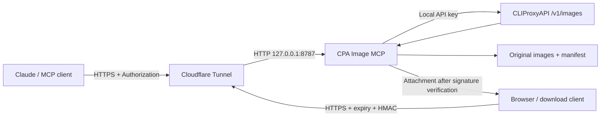

# CPA Image MCP

**English** | [简体中文](README.zh-CN.md)

A remote MCP wrapper for an existing [CLIProxyAPI](https://github.com/router-for-me/CLIProxyAPI) image endpoint. It lets Claude and other cloud-based MCP clients generate, edit, and download full-resolution images, with reusable signed download links and automatic retention cleanup.

All examples use `images.example.com`. Replace it with your own domain when deploying. This repository contains no real account credentials, deployment domains, images, logs, or environment files.

## Features

| Tool | Purpose |
| --- | --- |
| `generate_image` | Generate an image and return its ID, requested/actual dimensions, and a 512px preview |
| `edit_image` | Edit an image by ID, preserving the original and creating a new ID |
| `get_image` | Return full-resolution MCP ImageContent/base64, optionally resizing proportionally or converting to JPEG |
| `list_images` | List images still within their retention period and today's usage |

All four tools include `download_url` and `download_expires_at` in their results. Download links require no API request headers, remain valid for 72 hours by default, and can be reused. Original images are retained for 3 days by default, with cleanup at startup and every hour.

**Note the deletion default for `get_image`:** `delete_after_return=True` deletes the original image from the server after the HTTP response containing the image at its original dimensions has been fully sent. Its download links then stop working. Pass `delete_after_return=False` to keep the links usable or to continue editing or syncing the image. Thumbnails and ordinary link downloads do not trigger this deletion.

## How it works



- The MCP service listens only on the loopback address. No additional public port is needed on a NAT VPS.
- MCP connects to CPA at `http://127.0.0.1:8317/v1` by default and sends MCP heartbeats while waiting for image generation.
- Generation and editing return small previews. Original images are transferred separately as MCP image content or HTTPS attachments.
- HMAC uses an independent random key and binds the image ID, relative path, and expiry time. URLs contain neither the CPA API key nor the MCP token.
- `size` is passed as width × height, with additional prompt guidance for dimensions, orientation, and aspect ratio. Returned dimensions are decoded from the actual image bytes. If the upstream service does not honor the requested dimensions, the result explicitly reports the mismatch and preserves the upstream image.

This project does not deploy, sign in to, or modify CPA, and does not provide accounts. You need your own CPA instance with an authorized, working image backend. The verified setup includes Debian 12, Python 3.11, CLIProxyAPI 8.0.30, and MCP Python SDK 1.30.0. For other backends, check image endpoint and model compatibility.

## 1. Prepare your VPS and CPA

The installer supports **Linux with systemd and Python 3.10+**. It stops explicitly on Alpine/OpenRC rather than automatically switching service managers. Make sure Python venv/ensurepip is available first; the installer does not automatically upgrade system packages.

On Debian/Ubuntu, install the prerequisites:

```bash
sudo apt-get update
sudo apt-get install -y python3 python3-venv ca-certificates curl git
```

Confirm that CPA's `/v1/images/generations` and `/v1/images/edits` endpoints work and support your configured model. This service only sends requests to those endpoints; it does not read or modify CPA's configuration or account files.

## 2. Install the service

```bash
git clone https://github.com/Bing2000me/cpa-image-mcp.git
cd cpa-image-mcp
sudo bash install.sh
```

On the first run, the installer only creates `/etc/cpa-image-mcp.env` with permissions `0600` and generates separate random values for `MCP_TOKEN` and `DOWNLOAD_SIGNING_KEY`. It does not print the keys, create the service user, or install the application or service yet.

Edit the file on the VPS:

```bash
sudo nano /etc/cpa-image-mcp.env
```

Set at least:

```dotenv
CPA_API_KEY=your-own-cpa-api-key
CPA_BASE=http://127.0.0.1:8317/v1
PUBLIC_HOST=images.example.com
```

Replace the example domain and keep the automatically generated random keys. Quote values containing spaces, `#`, or other special characters. Leave `MCP_SECRET` empty to use request-header authentication.

Run the installer again, then check the service:

```bash
sudo bash install.sh
systemctl is-active cpa-image-mcp
curl http://127.0.0.1:8787/healthz
```

The expected outputs are `active` and `ok`, respectively. The application is installed at `/opt/cpa-image-mcp`, stores data in `/var/lib/cpa-image-mcp/images`, runs as the dedicated `cpaimg` user, and starts at boot. During upgrades, existing code, environment configuration, and the systemd unit are backed up to `/var/backups/cpa-image-mcp/<UTC-timestamp>/`. The configuration helper also backs up the environment file before filling in missing settings. Upgrades preserve existing non-empty credentials.

## 3. Connect your existing HTTPS tunnel

Add a Public Hostname / application route to your existing Cloudflare Tunnel:

| Field | Example |
| --- | --- |
| Hostname | `images.example.com` — replace with your own domain |
| Service type | **HTTP** |
| Service URL | `127.0.0.1:8787` |

Cloudflare provides HTTPS externally; the connection to the origin uses HTTP. Do not enter `https://127.0.0.1:8787`. Keep existing routes and leave CPA and VPN ports unchanged.

If you manage the tunnel with a local YAML file, add the route before the catch-all 404 rule:

```yaml
ingress:
  # Keep your existing routes here.
  - hostname: images.example.com
    service: http://127.0.0.1:8787
  - service: http_status:404
```

Back up the configuration first, then follow the [official Cloudflare Tunnel documentation](https://developers.cloudflare.com/cloudflare-one/networks/connectors/cloudflare-tunnel/) to validate it, bind DNS, and apply the change. The installer does not modify tunnels, DNS, or firewall rules.

Check from another device:

```bash
curl https://images.example.com/healthz
curl -s -o /dev/null -w '%{http_code}\n' -X POST https://images.example.com/mcp
```

The expected outputs are `ok` and `401`. If the local check succeeds but the public endpoint returns 502, first verify the origin's HTTP service type and address.

## 4. Set up a Claude custom connector

| Setting | Value |
| --- | --- |
| URL | `https://images.example.com/mcp` — replace with your own domain |
| Authentication | **No sign-in** — this service uses an API request header and does not implement OAuth |
| Request header name | `Authorization` |
| Request header value | `Bearer <MCP_TOKEN>` — include one space after `Bearer` |

Read `MCP_TOKEN` from the environment file on the VPS and enter it directly into the client's private settings. `MCP_TOKEN` is the MCP service's credential, separate from `CPA_API_KEY`. After connecting, you should see four tools.

Example request for `generate_image`:

```json
{"prompt":"A watercolor lighthouse at dusk","size":"1024x1536","quality":"low","name_hint":"lighthouse"}
```

To keep the original available for repeated downloads during the link's validity period, call `get_image` with:

```json
{"image_id":"ID-from-the-generation-result","delete_after_return":false}
```

If you only want to download the image, you can use the `download_url` from the generation result or `list_images` directly, without calling `get_image` again.

## Configuration

See [.env.example](.env.example) for the complete template. Keep real environment files outside the repository.

| Variable | Default | Purpose |
| --- | --- | --- |
| `CPA_API_KEY` | Required | API credential for your own CPA instance |
| `CPA_BASE` | `http://127.0.0.1:8317/v1` | Base URL of CPA on the same VPS; adjust the port as needed |
| `IMAGE_MODEL` | `gpt-image-2` | Backend image model |
| `PUBLIC_HOST` | Replace the example | Public HTTPS hostname, without a scheme or path |
| `MCP_TOKEN` | Randomly generated by the installer | Request-header authentication; at least 24 characters using letters, digits, `_`, or `-` |
| `MCP_SECRET` | Empty | Optional secret path segment; usually unnecessary |
| `DOWNLOAD_SIGNING_KEY` | Independently generated by the installer | HMAC signing key, at least 32 characters; changing it invalidates existing links |
| `DOWNLOAD_TTL_HOURS` | `72` | Link validity in hours; a positive integer |
| `IMAGE_RETENTION_DAYS` | `3` | Image retention in days; a positive integer |
| `DAILY_LIMIT` | `40` | Maximum daily generation/editing calls; deleting images does not restore quota |
| `PREVIEW_PX` | `512` | Maximum preview side length |
| `PORT` | `8787` | Local listening port; also update the tunnel origin if changed |
| `TZ_NAME` | `Asia/Shanghai` | Time zone for date grouping and daily quota |
| `IMAGE_DIR` | `/var/lib/cpa-image-mcp/images` | Data directory, used with systemd's StateDirectory |

After changing the environment file, run `sudo systemctl restart cpa-image-mcp`. CPA does not need to be restarted.

## Download links, retention, and deletion

A signed URL looks like this:

```text
https://images.example.com/download/<image_id>?expires=<UNIX-seconds>&token=<HMAC-signature>
```

- The same link supports repeated GET or HEAD requests. Downloading does not consume generation quota or delete the original image.
- The effective expiry is the earlier of “current time + link validity” and “image creation time + retention period.” Issuing a new link does not extend image retention.
- `download_expires_at` is a timezone-aware ISO 8601 UTC timestamp.
- Responses include the image's actual `Content-Type`, `Content-Disposition: attachment` with the original filename, and headers that disable caching.
- Invalid signatures and missing or deleted originals return 404. A valid signature with an expired link or retention period returns 410. Anyone with the link can download the image, so treat the link as a temporary credential.
- By default, `get_image` deletes the original after the HTTP response containing the image at its original dimensions has been fully sent. The server cannot confirm whether the client saved it. Pass `delete_after_return=False` to retain it. Resized images do not trigger deletion.

Cleanup runs at startup and every hour. It removes expired originals, associated thumbnails, and manifest entries, as well as expired orphaned images in the image directory. It also removes associated records when an original is missing. Expired or missing entries are hidden from image lists and sync manifests immediately, without waiting for the next physical cleanup. Cleanup stays within the image directory and does not delete usage files. The 512px previews are generated in memory without extra files on disk.

## Optional: sync original images to your computer

`sync_images.py` downloads only originals that are not already present locally. Only images still retained on the server can be synced; images already deleted by `get_image` cannot be synced again.

Set these variables in your computer's private environment configuration:

```bash
export CPA_IMG_BASE="https://images.example.com"
export CPA_IMG_TOKEN="<your-MCP_TOKEN>"
python3 sync_images.py ./local-images
```

To filter by date:

```bash
python3 sync_images.py ./local-images --since 2026-01-01
```

The sync client sends an explicit User-Agent. If Cloudflare still rejects requests, check the access controls on your domain.

## Testing and development

```bash
python3 -m venv .venv
.venv/bin/python -m pip install -r requirements.txt
.venv/bin/python -m unittest discover -s tests -v
bash -n install.sh
```

Tests use only synthetic images, temporary directories, and fake credentials. They do not call CPA or consume generation quota. Coverage includes original image bytes, resizing and formats, dimension forwarding, deletion after a response finishes sending, retention on errors or disconnects, signature tampering, expiry, repeated downloads, response headers, cleanup boundary protection, lifecycle behavior, and configuration generation, permissions, backups, and idempotency. The [GitHub Actions template](examples/github-actions-tests.yml) supports testing multiple Python versions. It is not enabled by default. To enable it, use GitHub authorization with workflow permission, copy it to `.github/workflows/tests.yml`, and commit the file.

Project layout:

```text
server.py                  MCP tools, downloads, and cleanup
install.sh                 systemd installer
scripts/configure_env.py   Private environment file generation, validation, and health checks
cpa-image-mcp.service      systemd unit
.env.example               Configuration template with empty credentials
sync_images.py             Optional local sync client
tests/                     Isolated tests without real credentials
read.md                    Brief setup guide (Chinese)
```

## Troubleshooting

- **Missing `ensurepip` / venv:** Install your distribution's `python3-venv` package rather than switching service frameworks to work around it.
- **Service fails to start:** Run `journalctl -u cpa-image-mcp -n 50` on the server. Remove sensitive content before sharing logs.
- **Original image link no longer works:** Check `download_expires_at`, whether the image has exceeded its retention period, and whether `get_image` deleted it by default.
- **Portrait dimensions do not match:** Use the reported actual dimensions. The service preserves the upstream image; it does not rotate or stretch it to fake the requested dimensions, or automatically repeat generation to probe for a match.
- **A large image exceeds the MCP client's size limit:** Use the signed download link, or request a smaller image with `max_side` / `format="jpeg"`.

This project depends on the [MCP Python SDK](https://github.com/modelcontextprotocol/python-sdk), [httpx](https://github.com/encode/httpx), and [Pillow](https://github.com/python-pillow/Pillow). See [LICENSE](LICENSE) for the MIT license.
