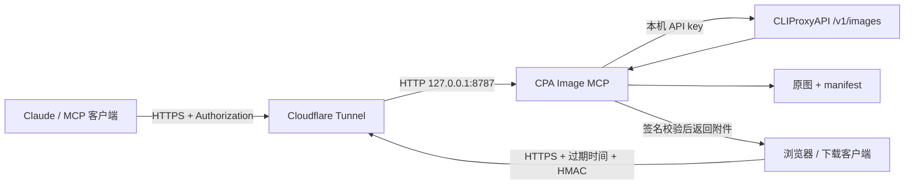

# CPA Image MCP

[English](README.md) | **简体中文**

把已运行的 [CLIProxyAPI](https://github.com/router-for-me/CLIProxyAPI) 图片接口包装成远程 MCP 服务，让 Claude 等云端客户端生成、编辑和下载原图。

Remote MCP wrapper for your own CLIProxyAPI image endpoint: generation, editing, full-resolution image content, reusable signed downloads, and automatic retention cleanup.

所有示例均使用 `images.example.com`。部署时请换成自己的域名；仓库不包含真实账号凭据、部署域名、图片、日志或环境文件。

## 能做什么

| 工具 | 用途 |
| --- | --- |
| `generate_image` | 生图，返回图片 ID、请求/实际尺寸及 512px 预览 |
| `edit_image` | 按图片 ID 编辑，保留原图，生成新 ID |
| `get_image` | 返回全尺寸 MCP ImageContent/base64，可等比例缩小或转 JPEG |
| `list_images` | 列出仍在保留期内的图片及今日用量 |

四个工具都附带 `download_url` 和 `download_expires_at`。下载链接无需 API 请求头，默认有效 72 小时，可重复下载。原图默认保留 3 天，服务启动时及每小时清理一次。

**注意 `get_image` 的删除默认值：** `delete_after_return=True` 会在原尺寸图片的 HTTP 响应完整发送后删除服务器原图，下载链接随之失效。需要链接继续可用、继续编辑或同步时，传 `delete_after_return=False`。缩略图和普通链接下载不会触发这项删除。

## 原理



- MCP 只监听回环地址，不需要为 NAT VPS 增加公网端口。
- MCP 到 CPA 默认走 `http://127.0.0.1:8317/v1`；生图等待期间发送 MCP 心跳。
- 生图/编辑的预览保持小体积；原图单独以 MCP 图片内容或 HTTPS 附件传输。
- HMAC 使用独立随机密钥，绑定图片 ID、相对路径和截止时间。URL 不含 CPA key 或 MCP token。
- `size` 按宽×高传递，同时补充尺寸、方向和纵横比提示词；返回尺寸按实际图片字节解码。若上游没有遵守尺寸，明确提示，保留上游原图。

这个项目不负责部署、登录或修改 CPA，也不提供账号。你需要自己的 CPA 实例及其已授权、能正常使用的图片后端。已验证组合包括 Debian 12、Python 3.11、CLIProxyAPI 8.0.30、MCP Python SDK 1.30.0；其他后端需确认图片接口和模型兼容性。

## 1. 准备 VPS 与 CPA

安装器适用于 **systemd + Python 3.10+ 的 Linux**。Alpine/OpenRC 会明确停止，不会自动改写服务方案。先准备 Python venv/ensurepip；安装器不自动升级系统软件包。

Debian/Ubuntu 可先执行：

```bash
sudo apt-get update
sudo apt-get install -y python3 python3-venv ca-certificates curl git
```

确认 CPA 的 `/v1/images/generations` 和 `/v1/images/edits` 可用，且支持配置的模型。服务只向这些接口发请求，不读取或改写 CPA 的配置/账号文件。

## 2. 安装服务

```bash
git clone https://github.com/Bing2000me/cpa-image-mcp.git
cd cpa-image-mcp
sudo bash install.sh
```

首次运行仅创建 `/etc/cpa-image-mcp.env`（0600），自动为 `MCP_TOKEN` 和 `DOWNLOAD_SIGNING_KEY` 分别生成随机密钥，不打印密钥，不安装用户、应用或服务。

在 VPS 本机编辑这个文件：

```bash
sudo nano /etc/cpa-image-mcp.env
```

至少设置：

```dotenv
CPA_API_KEY=your-own-cpa-api-key
CPA_BASE=http://127.0.0.1:8317/v1
PUBLIC_HOST=images.example.com
```

替换示例域名，并保留自动生成的随机密钥。值若含空格、`#` 或其他特殊字符，请使用引号。`MCP_SECRET` 默认留空，使用请求头鉴权。

再次执行：

```bash
sudo bash install.sh
systemctl is-active cpa-image-mcp
curl http://127.0.0.1:8787/healthz
```

预期分别为 `active` 和 `ok`。应用安装到 `/opt/cpa-image-mcp`，数据目录为 `/var/lib/cpa-image-mcp/images`，以独立 `cpaimg` 用户运行并开机启动。升级时备份已有代码、环境和 unit 文件到 `/var/backups/cpa-image-mcp/<UTC时间>/`；助手补配置前也会备份环境文件。升级不覆盖已有非空凭据。

## 3. 接入现有 HTTPS 隧道

在已有 Cloudflare Tunnel 新增一条 Public Hostname / 应用路由：

| 字段 | 示例 |
| --- | --- |
| Hostname | `images.example.com`，换成自己的域名 |
| Service type | **HTTP** |
| Service URL | `127.0.0.1:8787` |

外部由 Cloudflare 提供 HTTPS，源站连接使用 HTTP。不要填 `https://127.0.0.1:8787`。保留已有路由，不改 CPA 或 VPN 的端口。

若隧道由本地 YAML 管理，在兜底 404 之前增加：

```yaml
ingress:
  # 保留这里原有的路由。
  - hostname: images.example.com
    service: http://127.0.0.1:8787
  - service: http_status:404
```

先备份配置，再按 [Cloudflare Tunnel 官方文档](https://developers.cloudflare.com/cloudflare-one/networks/connectors/cloudflare-tunnel/)验证配置、绑定 DNS 并应用。安装脚本不会操作隧道、DNS 或防火墙。

从另一台设备检查：

```bash
curl https://images.example.com/healthz
curl -s -o /dev/null -w '%{http_code}\n' -X POST https://images.example.com/mcp
```

预期为 `ok` 和 `401`。如果本机正常而公网返回 502，先核对源站的 HTTP 类型和地址。

## 4. Claude 自定义连接器

| 项目 | 内容 |
| --- | --- |
| URL | `https://images.example.com/mcp`，替换为自己的域名 |
| Authentication | **No sign-in**，本服务使用 API 请求头而不实现 OAuth |
| Request header name | `Authorization` |
| Request header value | `Bearer <MCP_TOKEN>`，Bearer 后有一个空格 |

在 VPS 本机读取环境文件中的 `MCP_TOKEN`，直接填入客户端的私有设置。`MCP_TOKEN` 是 MCP 自己的凭据，不是 `CPA_API_KEY`。连接后应看到四个工具。

示例请求：

```json
{"prompt":"水彩风格的黄昏灯塔","size":"1024x1536","quality":"low","name_hint":"灯塔"}
```

需要在链接有效期内反复下载时：

```json
{"image_id":"从生成结果取得的ID","delete_after_return":false}
```

以上第二段用于 `get_image`。只想下载时，也可直接使用生成结果或 `list_images` 中的 `download_url`，无需再次调用 `get_image`。

## 配置项

完整模板见 [.env.example](.env.example)。真实环境文件必须保留在仓库之外。

| 变量 | 默认值 | 用途 |
| --- | --- | --- |
| `CPA_API_KEY` | 必填 | 自己的 CPA 接口凭据 |
| `CPA_BASE` | `http://127.0.0.1:8317/v1` | 同机 CPA 基础地址，按实际端口修改 |
| `IMAGE_MODEL` | `gpt-image-2` | 后端图片模型 |
| `PUBLIC_HOST` | 需替换示例 | 公网 HTTPS 域名，不带协议/路径 |
| `MCP_TOKEN` | 安装器随机生成 | 请求头鉴权，至少 24 位字母/数字/`_`/`-` |
| `MCP_SECRET` | 空 | 可选的路径暗号，通常无需启用 |
| `DOWNLOAD_SIGNING_KEY` | 安装器独立随机生成 | HMAC 签名密钥，至少 32 位；更换后旧链接失效 |
| `DOWNLOAD_TTL_HOURS` | `72` | 链接有效期，正整数小时 |
| `IMAGE_RETENTION_DAYS` | `3` | 图片保留期，正整数天 |
| `DAILY_LIMIT` | `40` | 当日最大生图/编辑次数，删除图片不返还额度 |
| `PREVIEW_PX` | `512` | 预览最长边 |
| `PORT` | `8787` | 本机监听端口；修改时同步修改隧道源站 |
| `TZ_NAME` | `Asia/Shanghai` | 日期分组和日额度时区 |
| `IMAGE_DIR` | `/var/lib/cpa-image-mcp/images` | 数据目录，与 systemd StateDirectory 配合 |

修改环境文件后执行 `sudo systemctl restart cpa-image-mcp`，不需要重启 CPA。

## 链接、保留期与删除

签名 URL 类似：

```text
https://images.example.com/download/<image_id>?expires=<UNIX秒>&token=<HMAC签名>
```

- 同一链接可多次 GET 或 HEAD；下载本身不消耗生图额度，也不删除原图。
- 实际到期时间取「当前时间 + 链接有效期」与「图片创建时间 + 保留期」中较早者。生成新链接不会延长图片保留期。
- `download_expires_at` 使用带时区的 ISO 8601 UTC 时间。
- 响应带真实图片 `Content-Type`、原文件名 `Content-Disposition: attachment` 和禁止缓存的响应头。
- 坏签名、缺失或已删除原图返回 404；正确签名但链接/保留期已到返回 410。拿到链接的人可以下载，链接本身也应按临时凭据处理。
- `get_image` 默认完整发送原尺寸图片的 HTTP 响应后删除原图；服务端无法确认客户端是否已另存。传 `delete_after_return=False` 可保留。缩小后的图片不会触发删除。

清理在启动和每小时运行，删除到期原图、关联缩略图及清单记录，也清理图片目录中过期的孤立图片。原图不存在时清理关联记录。过期/缺失项会即时从列表和同步清单隐藏，不必等下一轮物理清理。清理不会越过图片目录，也不删除用量文件。512px 预览在内存中生成，不额外落盘。

## 可选：同步原图到本机

`sync_images.py` 只下载本地尚不存在的原图。保留在服务器上的图片才可同步；已经被 `get_image` 删除的图片无法再次同步。

在本机的私有环境配置中设置：

```bash
export CPA_IMG_BASE="https://images.example.com"
export CPA_IMG_TOKEN="<自己的MCP_TOKEN>"
python3 sync_images.py ./local-images
```

需要按日期筛选时：

```bash
python3 sync_images.py ./local-images --since 2026-01-01
```

同步客户端带有明确的 User-Agent；若 Cloudflare 仍拒绝请求，应检查自己域名的访问控制。

## 测试与开发

```bash
python3 -m venv .venv
.venv/bin/python -m pip install -r requirements.txt
.venv/bin/python -m unittest discover -s tests -v
bash -n install.sh
```

测试只使用合成图片、临时目录和假凭据，不调用 CPA、不消耗生图额度。覆盖图片原字节/缩放/格式、尺寸传递、发送完成后删除、错误/断连保留、签名篡改、到期、重复下载、响应头、清理范围保护、生命周期，以及配置生成/权限/备份/幂等性。[GitHub Actions 模板](examples/github-actions-tests.yml)可测试多个 Python 版本。模板默认不启用；需要时，使用具备 workflow 权限的 GitHub 授权，将其复制到 `.github/workflows/tests.yml` 后提交。

目录结构：

```text
server.py                  MCP 工具、下载与清理
install.sh                 systemd 安装入口
scripts/configure_env.py   私有环境文件生成、检查和健康检查
cpa-image-mcp.service      systemd unit
.env.example               空凭据模板
sync_images.py             可选本机同步客户端
tests/                     无真实凭据的隔离测试
read.md                    简短复刻入口
```

## 排错

- `ensurepip` / venv 缺失：安装系统的 `python3-venv`，不要通过更换服务框架绕过。
- 服务启动失败：在服务器本机执行 `journalctl -u cpa-image-mcp -n 50`。分享日志前自行移除敏感内容。
- 原图链接失效：检查 `download_expires_at`、图片是否超过保留期，或是否被 `get_image` 默认删除。
- 竖版尺寸不符：以返回的实际尺寸为准。本服务保留上游原图，不旋转或拉伸来伪造尺寸，也不会为试探而自动重复生图。
- 大图超出 MCP 客户端体积限制：改用签名下载链接，或用 `max_side` / `format="jpeg"` 获取较小图片。

本项目依赖 [MCP Python SDK](https://github.com/modelcontextprotocol/python-sdk)、[httpx](https://github.com/encode/httpx) 和 [Pillow](https://github.com/python-pillow/Pillow)。MIT 许可证见 [LICENSE](LICENSE)。
